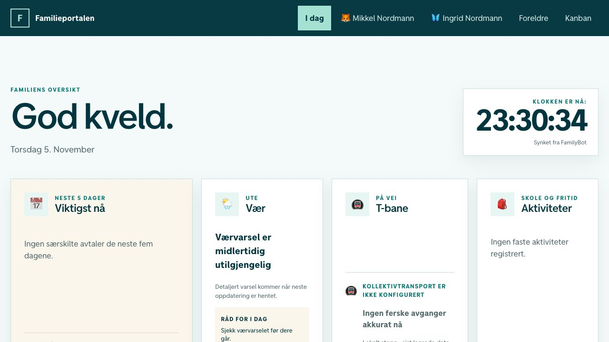

# Familieportalen

Familieportalen is the iPad-first local dashboard for FamilyBot. It gives a
Norwegian household a shared overview, child profiles, chores, 30-point reward
blocks, parent approval and Kanban. Optional cards show MET weather, Entur
departures, school Ukeplan data and Spond activities supplied by the sibling
Core repository.

The dashboard works from an empty database and requires no OpenClaw, Telegram,
mailbox, Spond, AI, Oda or HelloFresh account.



_Dashboard-only profile with fictional demo data; optional integrations are
deliberately unavailable._

## Install

Do not configure this repository independently first. Clone it beside
`familybot-core` and use the
[canonical step-by-step Mac setup guide](https://github.com/TrygveAasheim/familybot-core/blob/codex/readiness-review-fixes/GETTING_STARTED.md):

```bash
mkdir -p "$HOME/FamilyBot" && cd "$HOME/FamilyBot"
git clone --branch codex/readiness-review-fixes https://github.com/TrygveAasheim/familybot-core.git
git clone --branch codex/readiness-review-fixes https://github.com/TrygveAasheim/familybot-portal.git
cd familybot-core
git switch --detach REVIEWED_CORE_SHA
git -C ../familybot-portal switch --detach REVIEWED_PORTAL_SHA
uv run --python 3.12 scripts/install_familybot.py \
  --portal-repo ../familybot-portal
```

Replace the two SHA placeholders with the full compatible commit IDs in the
readiness PR handoff before running this block. They are not literal Git refs.

These commands select the development installation candidate. `main` has not
yet received the installer release. For pre-merge testing check out the exact
paired commits from the readiness PRs in both repositories; do not assume moving
`dev` contains unmerged fixes. See [review and test instructions](docs/READINESS_REVIEW.md).

The Core installer owns onboarding, the canonical config and Core schema. It
creates Portal schema version 2, builds this app, installs the local service and
verifies it. The tested Portal baseline is Node.js `22.22.3` through `22.x` and
Python 3.12.

Existing households must use the canonical guide's explicit upgrade procedure,
not the fresh-install command above. Preserve the actual workspace/runtime and
stop all database users first. Upgrades no longer reseed archived chores or
repair deliberately inactive rewards. Portal validates its owned schema before
committing migrations and before API startup. Fixture/CI success does not certify
your live installation; this candidate is not deployed by merging its source.

For a privacy-safe prerequisite report before installation:

```bash
cd ../familybot-core
uv run --python 3.12 scripts/check_setup.py --mode source --profile dashboard
```

## Dependency and ownership contract

```text
familybot-core/       canonical configuration, Core schema/facts, ingestion
familybot-portal/     Portal schema, curated API, UI, chores/rewards/groceries
$HOME/.familybot/     private config, PIN, SQLite, credentials, logs, backups
```

Both repositories share one private SQLite file. Core owns migration component
`core` at version 1. Portal owns component `portal` through version 2 and refuses
to start without the compatible Core marker. Portal does not create or migrate
Core-owned facts.

See [the development and ownership map](docs/DEVELOPMENT_GUIDE.md) and
[the data boundary](docs/DATA_BOUNDARY.md).
The cross-repository before/after assessment is maintained in Core's
`docs/INSTALLATION_READINESS.md`.

## Product profiles

- **Dashboard:** this UI, chores, rewards and Kanban. Weather and Entur are
  optional and degrade independently.
- **Connected organizer:** Core adds selected school email/PDF, Spond and
  scheduled deterministic processing.
- **AI family agent:** Core adds optional model-assisted interpretation,
  briefings and Telegram with deterministic fallbacks.

The browser never becomes an OpenClaw control surface. Raw email, provider
credentials, Spond payloads, Telegram identifiers and arbitrary files are not
returned by the API.

## Grocery capabilities

Both are disabled by default and independent of the product profiles.

- **Oda** uses the hosted Oda MCP service through a server-side OAuth adapter.
  The browser receives no bearer token or generic MCP/tool endpoint. Bounded
  recipe/product/cart actions are available; checkout stays at Oda.
- **HelloFresh Norway** is experimental and relies on an unsupported,
  reverse-engineered provider web contract. Public menu and account access have
  separate flags. Account writes are limited to confirmed meal
  replace/add/remove and exact-week pause/resume; subscription plan, address,
  payment and checkout are unavailable.

Provider changes can break either integration without affecting the family
dashboard. Details are in [Oda groceries](docs/ODA_GROCERIES.md) and the
[HelloFresh contract](docs/HELLOFRESH_NORWAY.md).
Scheduled HelloFresh image prefetch requires both public-menu and account flags.
Disabling either stops new prefetch invocations before they read retained tokens;
redeployment also removes the generated image job. Stored tokens are not deleted.

## Security boundary

The managed service is intentionally LAN-only and plain HTTP. Exact Origin
checks, random in-memory tokens, a rate-limited parent PIN and action allowlists
provide defense in depth, but they do not protect against a hostile device that
can observe or modify LAN traffic. Never port-forward ports `3000` or `8788`.
Use a trusted household LAN; add authenticated VPN access and reviewed TLS for
remote or mutually untrusted networks.

Children can complete their chores without a login. Parent setup, approval,
reset and Kanban writes require the parent session. Oda and HelloFresh follow an
explicit trusted-household policy and are not parent-PIN gated. Their UI asks
for confirmation before the bounded consequential provider writes.

## Development

Read [AGENTS.md](AGENTS.md), then
[docs/DEVELOPMENT_GUIDE.md](docs/DEVELOPMENT_GUIDE.md). The normal gate is:

```bash
npm ci
npm run lint
npm test
```

`npm test` runs dependency audits, Python API tests, documentation checks,
TypeScript, the production build and rendered HTML contracts. The Core suite
owns the cross-repository empty-install lifecycle and macOS clean-install CI.

The runtime probe requires explicit `--workspace` and `--host` arguments and
must target an isolated test installation. Exit zero means only its automated
probes passed, never full release acceptance. Unperformed browser, iPad and
provider criteria remain `not_run`; disabled capabilities are `not_applicable`.

For a cold engineering handoff, use
[docs/NEW_SESSION_VERIFICATION.md](docs/NEW_SESSION_VERIFICATION.md). Feature
status and unsupported boundaries are listed in
[docs/FEATURE_MAP.md](docs/FEATURE_MAP.md).
