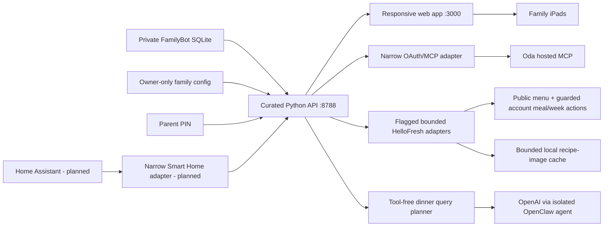

# Development guide and ownership map

This is the canonical cold-start guide for Familieportalen. It explains what the
repository owns, where changes belong and how it remains safely separated from
FamilyBot's reliability core.

## Product role

Familieportalen is the direct iPad-first interface for the household. Its first
screen is a calm family overview. Children can open their own profiles and use
chores/rewards without adult help. Parents can review and manage chores, reward
goals, weekly full-week achievements, surprise redemptions and the family Kanban
board.
OpenClaw is optional: the AI/Telegram profile and separately opted-in Oda dinner
AI use it; the dashboard
must remain useful and deployable without it.
For child-chore creation from Telegram, OpenClaw uses the two-step interview
bridge documented in `docs/TELEGRAM_CHILD_CHORES.md`; the portal remains the
owner of validation and writes.

The sibling `familybot-core` repository owns ingestion, parsing, normalized
facts, briefings, delivery and health. This repository presents a curated view;
it does not decide whether an email or Telegram delivery succeeded.

## Runtime flow

The production supervisor runs API and web processes together. Bonjour advertises
the web service. The API and database remain on the Mac mini.

## Code map

| Area | Owning files | Risk notes |
| --- | --- | --- |
| Main family/child/parent UI | `app/_components/FamilyConsole.tsx` | User-visible; touch, accessibility and state-transition risk |
| Global layout and responsive design | `app/globals.css` | Verify portrait, landscape, 200% zoom and no hover dependency |
| Curated API and authorization | `local_api/familybot_api.py` | Security-critical field/action allowlist, including parent-gated Kanban mutations |
| Oda groceries | `local_api/oda_mcp.py`, `local_api/oda_dinner.py`, Oda routes in `local_api/familybot_api.py` | OAuth secrecy, bounded model context, strict public recipe host/schema validation, kiosk return navigation, account-data exposure, explicit cart-mutation and provider-failure boundary |
| HelloFresh experiment | `local_api/hellofresh_norway.py`, the `local_api/hellofresh_account*.py` facade/contract/transport/recipe/mutation modules, `local_api/hellofresh_images.py`, HelloFresh routes in `local_api/familybot_api.py` | Separate disabled-by-default flags; one trusted-LAN password request, fixed-origin and path-allowlisted browser-TLS transport, token-only persistence, selected-first account reads, exact-week meal/pause writes, stale-view guards, read-after-write verification and a host/type/size-bounded local public-image cache |
| Dashboard schema and backup | `local_api/dashboard_migration.py` | Data-critical; idempotent migration and pre-migration backup required, including weekly achievement history |
| Config reader | `local_api/family_config.py` | Must match the one core-owned configuration contract |
| Process supervision | `local_service/run_service.py` | Operational; both processes fail/restart as a group |
| Local deployment | `scripts/deploy-local.sh`, `launchd/` | Production mutation; preflight and rollback required |
| HelloFresh image warm-up | `scripts/prefetch_hellofresh_images.py`, `launchd/ai.familybot.portal-images.plist` | Portal-owned 04:45 job; public images only, bounded disk use, cached stale fallback, count-only logs |
| API tests | `local_api/test_familybot_api.py` | Authorization, response minimization and state transitions |
| Release acceptance | `tests/acceptance.py`, `tests/rendered-html.test.mjs` | Current release gate |
| Static quality and dependency security | `pyproject.toml`, `requirements-dev.txt`, `scripts/python-quality.sh`, `package.json` | Oxlint with React/hooks/a11y rules, Ruff, medium-severity Bandit with narrow inline justifications, npm audit and pip-audit are fail-closed CI/release gates |

`worker/index.ts` and `examples/d1/` are framework/scaffold surfaces, not the
LAN production data path. Do not move family state into a cloud worker or D1
because those directories exist.

The deploy script resolves and records the selected Node executable in the
installed LaunchAgent, then builds the API in an isolated Python 3.12 runtime.
Do not reintroduce `/opt/homebrew/bin` as an executable assumption; Apple
Silicon is tested, but path discovery keeps Intel/custom Homebrew layouts
diagnosable. The canonical host software and minimal OpenClaw instructions live
in Core's `GETTING_STARTED.md`.

New installations deploy beneath `$HOME/.familybot`; legacy paths remain
supported only through explicit environment overrides. Do not reintroduce an
OpenClaw workspace as a dashboard prerequisite.

## Data ownership

Core-owned tables are read through explicit queries. Portal-owned chores,
completions, reward goals and weekly achievement tables are created by
versioned Portal migrations. The shared ledger currently requires Core schema
1 and Portal schema 2. Before API bind, startup verifies the Core version
contract, contiguous Portal history/names/checksums, required owned columns,
foreign keys and SQLite integrity. Status uses the same validation, not merely
version numbers. All pending Portal DDL/markers and final validation run in one
transaction; validation failure rolls them back together. This is not a full
security audit or an atomic transaction spanning Core and Portal.

Starter chores/rewards belong to first installation. Deployment runs migrations
without starter seeds or default-reward repair; those remain explicit maintenance
operations. Archived matching chores count as existing even during an explicit
seed. Upgrade through Core's canonical recovery guide, with all writers stopped
and the installed workspace/runtime retained. A pre-upgrade backup covers data
changes that happen before Portal migration; a Portal-only backup is too late
to recover earlier Core/calendar changes.
The portal may add a separate add-on schema, but it cannot reuse core ledgers or
raw payload columns as a convenient storage area.

Weekly achievement progress is now derived as continuous portal completion
points in `pending` or `awarded` status. Every 30 points makes one full block;
the remainder is shown in a new progress bar immediately. Rejected completions
have zero points and do not contribute. The full-block counter continues until
a parent redeems a surprise. See [the weekly achievement specification](WEEKLY_ACHIEVEMENTS.md)
for the contract and state transitions.

The browser is not entitled to every field returned by SQLite. New response
fields require an explicit privacy decision in `docs/DATA_BOUNDARY.md` and
negative tests for raw/private material.

## UI principles

- Family overview first; detailed child, parent and add-on pages second.
- Large tap targets, immediate feedback and minimal typing.
- No essential hover state.
- Plain family language rather than kanban/admin terminology for children.
- Status text is derived from measured state and timestamp, not optimism.
- Keep DNB Eufemia-inspired visual consistency without coupling business logic
  to a component library.
- Grocery ordering stays direct and task-focused. The dinner planner can only
  produce Oda recipe search phrases; explicit cart actions remain separate and
  checkout/payment remain at Oda.
- The HelloFresh account experiment exposes only the reviewed meal-selection
  and exact-week pause contract. Every action is explicit, rejects stale state,
  preserves unrelated selected meals/add-ons and verifies provider state after
  the write. Subscription plan, servings, address, payment and checkout remain
  outside the allowlist.
- HelloFresh image delivery is a content-addressed cache, not a generic proxy.
  The browser cannot submit a source URL; only server-registered URLs from the
  reviewed CDN host allowlist can be downloaded and served.

## Core versus add-on changes

A school fact or delivery rule belongs in core. Its visual presentation belongs
here. Chores, rewards and weekly achievement surprises are portal-owned
add-ons. Smart Home is another add-on:
Home Assistant owns vendor integrations, a server-side adapter exposes an
allowlist, and the UI renders a separate `/smart-home` page. A Smart Home outage
must leave the family overview and child pages usable.

## Change workflow

1. Start at `AGENTS.md` and classify the change.
2. Confirm the API/data owner and whether SQLite will mutate.
3. Write the standard change record in [`CHANGE_PROTOCOL.md`](CHANGE_PROTOCOL.md)
   with evidence, acceptance criteria, security/privacy, rollback and docs.
4. Update the acceptance contract before or with user-visible behaviour.
5. Implement the smallest curated API and touch-first UI surface.
6. Run docs, lint, unit/build/rendered HTML and acceptance checks.
7. Deploy only from verified `dev`; confirm Bonjour, API origin and iPad use.

For cross-repository Ukeplan work, Core owns the source PDF, routing,
normalized facts and interpretation status. Portal must consume the curated
accepted interpretation in the scoped detail contract. The child overview should
remain a compact link to that page; do not duplicate the full interpretation in
the overview. Add regression assertions for the compact overview and the full
detail surface.

Use the core repository's `docs/CHANGE_PROTOCOL.md` for shared promotion,
security and rollback discipline.
